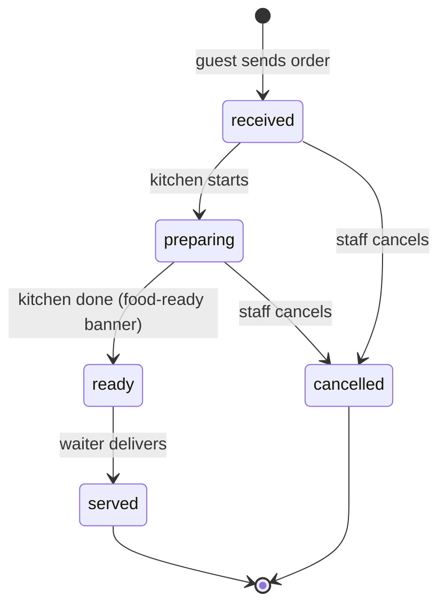
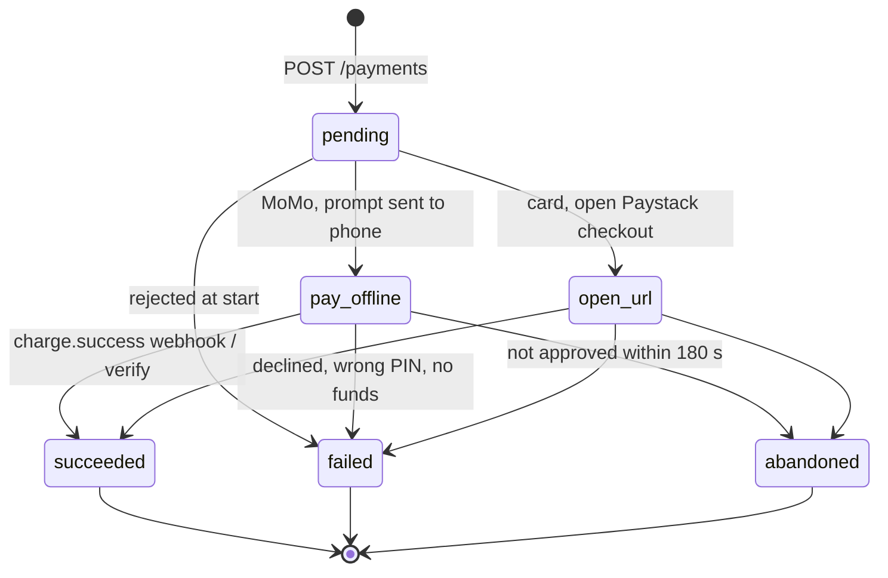
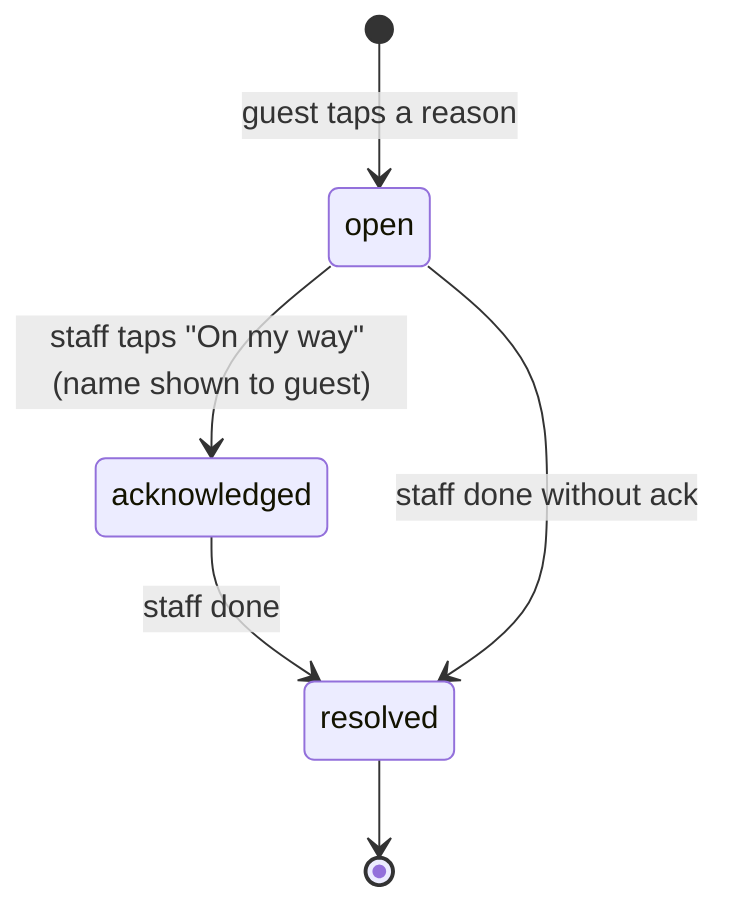
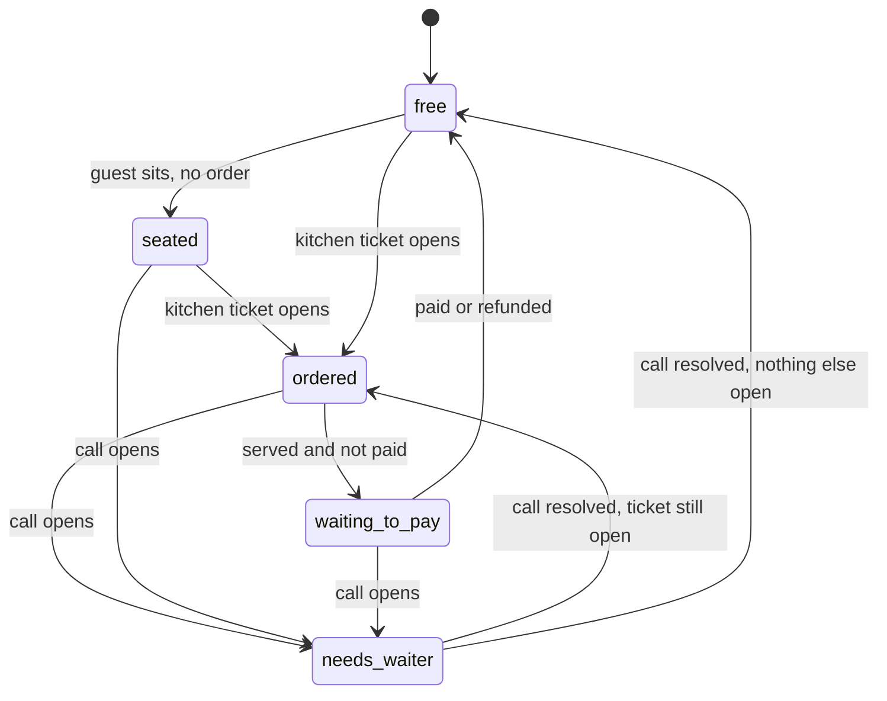

# Cravins: what we are building, how, and in what order

This is the master document for the coding agent. Read it all once, then follow the checklist in section 13. If something here conflicts with a render in `design/renders/`, the render wins for layout and this file wins for rules. Section 17 lists what to ask Clarke.

**Owner app layout (Clarke, 2026-11-07):** the owner app uses a sidebar dashboard layout with Cravins's colours, type, icons and words. For owner screens, that layout plus Clarke's written approval of the screenshots replaces the owner renders in `design/renders/`. Guest screens still match their renders.

Contents:

1. What Cravins is
2. Who uses it
3. The product map
4. Decisions already made
5. Stack and why
6. Repo layout
7. Code rules (hygiene)
8. Design system
9. State machines
10. API contract and mock layer
11. Slow networks and cheap Android phones
12. Launch market, money and the law
13. Phases and the ordered checklist
14. Testing and verification
15. Definition of done
16. CI, environments and release
17. Open questions for Clarke

---

## 1. What Cravins is

Cravins is a global product with a global mindset, launching in Africa first. The sample venues are in Accra, and Ghana is the default for currency, phone numbers and opening hours until a venue says otherwise. It is a QR-code table app for restaurants, chop bars, cafés and bars. A guest scans the code on their table and lands on that venue's own page in the phone's browser. No app to install, and no account. From there they can:

- read the menu and order
- call the waiter
- see where their food is
- pay with MoMo or card and split the bill
- connect to the Wi-Fi
- collect loyalty stamps
- leave a written or video review
- play a short game while they wait

The venue owner has a Cravins app (phone and web). In it they switch services on and off, customise their page, watch orders come in, and moderate video reviews.

The money goes straight to the venue's own Paystack account: each restaurant connects its own Paystack keys (decision of 2026-11-03). Cravins takes no cut of guest payments and **never holds anyone's money.**

The name on everything is **Cravins**. Never mention TakeOrder anywhere: code, comments, copy, commits or docs.

## 2. Who uses it

| User                                 | Where                                                              | What they need                                                                                                                     |
| ------------------------------------ | ------------------------------------------------------------------ | ---------------------------------------------------------------------------------------------------------------------------------- |
| **Guest**                            | Phone browser (Android mostly, many low-end, often on mobile data) | Fast first load, big tap targets, clear money words, works on a weak signal, their language                                        |
| **Owner**                            | Owner app on Android/iOS, or the same app on the web               | See orders and money, switch services, customise the page, moderate reviews, set up payouts                                        |
| **Staff** (manager, waiter, kitchen) | Owner app with a smaller role                                      | Waiters: orders and waiter calls. Kitchen: move orders to Being prepared and Ready. Managers: everything except payouts and staff. |

## 3. The product map

Clarke's order. Each product is a group of features. We build them in this order, frontend first.

| #   | Product     | What it is                                                                                                                                                                                                                  | Phase |
| --- | ----------- | --------------------------------------------------------------------------------------------------------------------------------------------------------------------------------------------------------------------------- | ----- |
| 1   | **Table**   | Guest page from the QR code, with the home screen, stories, menu, order, order status, call waiter, Wi-Fi, offers, about, the game, and the food-ready banner. Owner side: services, customise, orders dashboard and staff. | 1     |
| 2   | **Pay**     | Whole bill, equal split or "my items", with tips. MoMo (MTN, Telecel, AT) and card through Paystack, Paystack sandbox first. Split payments to the venue's subaccount; Cravins never holds funds.                           | 2     |
| 3   | **Loyalty** | Stamp card per venue, joined with a phone code and recorded consent. Stamps for paid orders and, optionally, a game high score.                                                                                             | 3     |
| 4   | **Reviews** | Written reviews (4–5 stars point to Google, 1–3 to private feedback). 15–30 s video reviews become story circles once the owner features them. Owner moderation.                                                            | 4     |
| 5   | POS         | Staff take orders and cash at the counter, print or share receipts.                                                                                                                                                         | 7     |
| 6   | Stock       | Track ingredients and items, with automatic "sold out".                                                                                                                                                                     | 8     |
| 7   | Orders      | Kitchen display, order history, takeaway and pickup, live push in place of polling.                                                                                                                                         | 9     |
| 8   | AI Waiter   | Answers questions and takes orders by text or voice in the guest's language.                                                                                                                                                | 10    |
| 9   | Marketing   | WhatsApp/SMS campaigns to members who agreed to marketing, plus offers and events.                                                                                                                                          | 11    |
| 10  | Insights    | Sales, best sellers, busy hours, review trends.                                                                                                                                                                             | 12    |
| 13  | Setup       | Self-serve onboarding: sign up, menu import, tables, QR sticker print, payout account.                                                                                                                                      | 13    |

Products 11 and 12 are not in Clarke's list; do not invent them. **Video menu** (short dish videos on the menu) is roadmap only: do not build it, and do not add it to the services list.

## 4. Decisions already made

These are settled. Do not reopen them.

- **Logo:** the SCAN FRAME mark. It is an orange #FC5205 circle with a white rounded square, QR corner marks, and a fork and knife cut out. The files are in `design/logo/` and the rules are in `design/brand.md` section 1.
- **Colours:** black and white base. #FC5205 is for the logo only. Buttons are #D24000, hover #BA3800, pressed #A33000, tint #FFF1EA. _2026-11-16:_ guest pages use the owner app's soft canvas behind white cards.
- **Fonts:** Inter for text and Unbounded for display.
- **Venue theming:** each venue sets one colour and a heading font. Contrast fallbacks follow `deriveTheme` (`design/prototype/theme.js`). Cravins-owned screens (the owner app, Customise, and "Powered by Cravins") always use Cravins orange.
- **Guest home:** an edge-to-edge banner with a round logo at bottom-left, then name, description, location and hours. Below that come the video-review story circles, then services in four sections (At your table, Rewards, Fun while you wait, More). Each service opens its own screen.
- **Game:** "Play while you wait" is for every guest. It has a weekly leaderboard, an optional loyalty stamp at the owner's target score, and the food-ready banner can appear over it.
- **Owner side:** review moderation, service toggles, the Customise page, and an orders dashboard.
- **Payments:** Paystack, test mode first. MoMo on MTN, Telecel and AT, plus card. _Changed 2026-11-03:_ each restaurant pastes its own Paystack public and secret keys (Settings > Integrations). The secret key is stored encrypted on the server only and never reaches the app, the browser or a log. No split payments, no pooled accounts, no payouts. Never hold funds. Manual methods (cash, card machine, bank transfer, MoMo to the merchant number) are marked paid by staff.
- **Two ways to order** _(2026-11-03)_: walk-in guests scan a **table QR** (no contact details, call waiter, ask for the bill). Online customers use the venue's **menu link** (`/<venue-slug>`) to order for pickup or delivery, and give a name and phone (plus an address for delivery). That contact data lives on the order only, never in the guest session, and is never logged.
- **Paystack fee** _(2026-11-16)_: the venue pays it unless the owner switches on "Pass fees to customers" (Integrations > Payments) and picks a share, 1–100%. 100% adds Paystack's whole fee (1.95% in Ghana, `src/lib/paystackFee.ts`) so the venue still receives the full bill. The guest sees it as its own line before paying and on the receipt. It applies only to payments in the app, never to cash, card machine, bank transfer or MoMo to the venue's number, and it never counts as paying for food. The server works it out.
- **Sign-in** _(2026-11-16)_: **Clerk**, paid from Clarke's Clerk credit, with our own screens built on Clerk's custom-flow APIs (no Clerk-drawn screens). Clerk sends the phone codes; Arkesel (about GH₵0.035 a code) is the fallback if Clerk's SMS to Ghana proves slow or costly. If Google sign-in is added, Sign in with Apple must be added too (App Store guideline 4.8). Moving sign-in to Clerk changes the contract's auth calls, so that goes in its own contract PR first.
- **Legal checks** _(2026-11-16)_: the PSP-licence question and DPC registration are done after the backend is built, before real phone numbers or real money.
- **Plans:** the owner plan badge and Billing page use the placeholder plans from `landing/src/content/pricing.ts` until real prices are set.
- **Build order:** frontend first against a fixed API contract and a mock. The backend comes only after Clarke approves the UI. _2026-11-03:_ Clarke approved the Phase 4b feature work: build all of its UI on the mock first, then hook in the backend.
- **Hosting** _(2026-11-16)_: the server (`server/`, Hono on Node) runs on **Heroku**, paid from Clarke's Heroku credit, on a Basic dyno ($7/month, always on; Clarke, 2026-11-16). A GitHub Actions workflow sends `server/` to Heroku on each merge to `main`. Migrations run in Heroku's release phase, once per deploy. Heroku Scheduler runs the payment check. The database is **Supabase** Postgres (project "Cravins", eu-west-1), reached through its pooled connection, with Row Level Security on every table so Supabase's public web API can't read them. Photos go in Supabase Storage. The web app stays on Vercel, but Vercel's free Hobby plan is for non-commercial use, so it moves to Vercel Pro or a free host that allows business use before launch.
- **Code style:** Clarke is learning, so code must be simple, readable, and commented where it is not obvious.

## 5. Stack and why

Checked on npm on 31 Oct 2026. **Do not pin these by hand.** Create the app with `npx create-expo-app@latest`, then add every Expo-related package with `npx expo install <pkg>` so the versions match the SDK. Before writing SDK code, read the docs for the installed version.

| Need                           | Choice                                                                                  | Version seen                      | Why                                                                                                                                                                                                                                                       |
| ------------------------------ | --------------------------------------------------------------------------------------- | --------------------------------- | --------------------------------------------------------------------------------------------------------------------------------------------------------------------------------------------------------------------------------------------------------- |
| Framework                      | Expo SDK (latest stable)                                                                | expo 58.0.22, react-native 0.88.1 | One codebase for the guest web app and the owner phone app. CNG means we never touch `ios/` or `android/`.                                                                                                                                                |
| Routing                        | Expo Router                                                                             | 58.0.29                           | File-based routes give real URLs on the web, which the QR codes need (`/mamas-kitchen/t/12`).                                                                                                                                                             |
| Language                       | TypeScript, `strict: true`, plus `noUncheckedIndexedAccess`                             | —                                 | Catches mistakes before Clarke sees them.                                                                                                                                                                                                                 |
| Web                            | react-native-web (bundled with Expo)                                                    | 0.21.4                            | Guests use the browser.                                                                                                                                                                                                                                   |
| Server data                    | TanStack Query                                                                          | 5.105.0                           | Caching, retries, polling and offline persistence in one place.                                                                                                                                                                                           |
| Local state                    | Zustand                                                                                 | 5.0.16                            | Cart, guest session and UI flags. Small and easy to read.                                                                                                                                                                                                 |
| Persistence                    | `@react-native-async-storage/async-storage` + `@tanstack/query-async-storage-persister` | 3.1.1 / 5.105.0                   | Works on web (localStorage) and native. Keeps the menu for offline use.                                                                                                                                                                                   |
| Secure tokens                  | expo-secure-store (native only)                                                         | 58.0.2                            | Owner tokens on the phone. On web, keep tokens in memory and sessionStorage (section 12.6).                                                                                                                                                               |
| API types                      | openapi-typescript + openapi-fetch                                                      | 7.13.0 / 0.17.0                   | Types come straight from `api/openapi.yaml`, so the app cannot drift from the contract.                                                                                                                                                                   |
| Runtime checks                 | zod                                                                                     | 4.6.7                             | Parse untrusted input at the edges: route params, storage, payment responses.                                                                                                                                                                             |
| Mock API                       | Our own in-memory mock client (section 10)                                              | —                                 | The same interface as the real client, so swapping is one env var. Optional MSW (3.0.3) for web tests.                                                                                                                                                    |
| Styling                        | `StyleSheet` + typed tokens from `design/tokens.json`                                   | —                                 | Nothing extra to learn or configure, and it works on web and native. NativeWind (4.2.7) was considered and rejected: it adds another build layer and a second way to style for a beginner.                                                                |
| Icons                          | lucide-react-native + react-native-svg                                                  | 1.66.0 / 15.16.0                  | Matches the brand (Lucide, 2 px stroke).                                                                                                                                                                                                                  |
| Images                         | expo-image                                                                              | 58.0.18                           | Caching, blurhash placeholders, WebP.                                                                                                                                                                                                                     |
| Video                          | expo-video                                                                              | 58.0.13                           | Story viewer and review playback.                                                                                                                                                                                                                         |
| Camera                         | expo-camera                                                                             | 58.0.14                           | Front-camera video reviews. **Check whether video recording works on web in this SDK.** If it doesn't, use a web-only `<input type="file" accept="video/*" capture="user">` fallback in `RecordVideo.web.tsx`.                                            |
| Animation                      | react-native-reanimated                                                                 | 4.7.1                             | Sheets, banner slide, the game. Interaction motion stays at 200 ms or less.                                                                                                                                                                               |
| Fonts                          | expo-font                                                                               | 58.0.11                           | Loads the WOFF2 subsets from `design/prototype/fonts/` (convert to TTF/OTF for native if needed).                                                                                                                                                         |
| i18n                           | i18next + react-i18next + expo-localization                                             | 26.5.12 / 17.1.9 / 58.0.5         | English is the only language a guest can select today. French, Portuguese, Spanish, Arabic and Swahili files exist from day one and show as Coming soon until native speakers fill them. Arabic is right-to-left. Never machine-translate without review. |
| Haptics                        | expo-haptics                                                                            | 58.0.7                            | A light tick on add-to-order and in the game (native only).                                                                                                                                                                                               |
| Unit and component tests       | jest-expo + @testing-library/react-native                                               | 58.0.13 / 14.1.0                  | Standard for Expo.                                                                                                                                                                                                                                        |
| Web end-to-end and screenshots | @playwright/test                                                                        | 1.64.1                            | Drives the guest web build at 390×844 and compares it with `design/renders/`.                                                                                                                                                                             |
| Native end-to-end              | Maestro (later, owner app)                                                              | —                                 | Simple YAML flows on an Android emulator.                                                                                                                                                                                                                 |
| Lint and format                | `npx expo lint` (eslint-config-expo 58.0.4) + Prettier                                  | —                                 | Expo's own config. Add rules from section 7.                                                                                                                                                                                                              |
| Git hooks                      | Husky 9 + lint-staged 17 + commitlint 21                                                | —                                 | Lint and type-check before commit, plus conventional commit titles.                                                                                                                                                                                       |
| CI                             | GitHub Actions (+ EAS Workflows for builds)                                             | —                                 | See section 16.                                                                                                                                                                                                                                           |
| Backend (Phase 5)              | Node + TypeScript, Hono, Postgres with Drizzle, in `server/` in the same repo           | —                                 | The same language as the app. Hono is small. Postgres for money. The final host is Clarke's call (section 17).                                                                                                                                            |

**Expo Go note:** Expo Go on phones can lag behind the newest SDK. Use a development build (expo-dev-client) for the owner app and test the guest app in the browser.

## 6. Repo layout

Group code by **feature**, not by file type. Each feature folder owns its screens' parts, hooks, pure logic and tests. Route files in `src/app/` stay thin: they read params, call one feature hook, and render one feature screen component.

```
cravins/
├─ AGENTS.md                 # rules for every coding agent, kept up to date
├─ BUILD.md                  # this file
├─ api/openapi.yaml          # the contract (source of truth for all endpoints)
├─ design/                   # renders, tokens, brand.md, logo (copied from the kit)
├─ assets/                   # app icon, splash, fonts (from design/logo/expo, design/prototype/fonts)
├─ src/
│  ├─ app/                   # Expo Router routes ONLY (see table below)
│  ├─ features/
│  │  ├─ venue/              # useVenue, VenueHeader, StoryRow, ServiceGrid, hours logic
│  │  ├─ menu/               # MenuScreen, ItemCard, ItemSheet, categories, dietary tags
│  │  ├─ cart/               # cartStore (zustand), totals (pure), CartBar
│  │  ├─ orders/             # placeOrder, useOrder (polling), OrderSteps, foodReady banner
│  │  ├─ waiter/             # reasons, useCallWaiter, WaiterSent
│  │  ├─ pay/                # bill split (pure), tips, PayScreen, MomoWait, paymentMachine
│  │  ├─ loyalty/            # StampCard, join flow (OTP + consent), stamp rules
│  │  ├─ reviews/            # ReviewForm, RecordVideo(.web).tsx, StoryViewer, upload
│  │  ├─ game/               # plateStack engine (pure), GameCanvas, leaderboard (local)
│  │  ├─ wifi/ offers/ feedback/ about/ reserve/ events/
│  │  ├─ theming/            # deriveTheme.ts (pure), VenueThemeProvider, contrast utils
│  │  └─ owner/
│  │     ├─ auth/            # OTP login, token storage, role guard
│  │     ├─ dashboard/       # live orders, waiter calls, today's takings
│  │     ├─ services/        # toggles + game stamp target
│  │     ├─ customise/       # branding form, live preview, contrast note
│  │     ├─ reviews/         # video moderation queue
│  │     └─ staff/ tables/ menu-editor/ payouts/
│  ├─ ui/                    # design-system parts used by many features: Button, Text, Card,
│  │                         # Sheet, Chip, Badge, IconButton, ListRow, Screen, Skeleton, Toast
│  ├─ lib/
│  │  ├─ api/                # schema.ts (generated), client.ts (interface), http.ts, index.ts
│  │  ├─ money.ts            # minor units <-> a currency symbol; GHS "GH₵65.50" is the sample
│  │  ├─ phone.ts            # country-aware E.164; Ghana +233 and the MoMo guess are the sample
│  │  ├─ time.ts             # opening hours, "Open now · until 10 PM"
│  │  ├─ storage.ts          # one wrapper over AsyncStorage / SecureStore
│  │  └─ env.ts              # reads EXPO_PUBLIC_* once, parsed with zod
│  ├─ mocks/                 # mockClient.ts, fixtures/*.json (copied from api/fixtures), media map
│  ├─ i18n/                  # index.ts, locales/en fr pt es ar sw (only en is filled)
│  └─ theme/                 # tokens.ts (generated from design/tokens.json), fonts.ts
├─ e2e/                      # Playwright tests + screenshot baselines
├─ scripts/                  # gen-api-types, gen-tokens, copy-fixtures, check-fixtures
├─ server/                   # empty until Phase 5
└─ .github/workflows/ci.yml
```

Rules for the layout:

- A feature may import from `ui/`, `lib/`, `theme/`, `i18n/` and **another feature's `index.ts` only**. It never reaches into another feature's files. Each feature folder exports its public pieces from `index.ts`.
- `ui/` never imports from `features/`.
- Pure logic (totals, split, loyalty, deriveTheme, the game engine, hours, payment machine) lives in plain `.ts` files with no React, next to a `.test.ts`.
- One component per file. A file over about 200 lines is a sign to split it.
- Platform-specific code goes in `.web.tsx` / `.native.tsx` files, never in `Platform.OS` branches spread through a component.

### Routes (`src/app/`)

Expo Router groups in brackets do not appear in URLs. The QR code opens `https://cravins.app/{venueSlug}/t/{table}`.

| Route file                                                                     | URL                   | Screen                                                                                         | Render to match                                                                                                   |
| ------------------------------------------------------------------------------ | --------------------- | ---------------------------------------------------------------------------------------------- | ----------------------------------------------------------------------------------------------------------------- |
| `_layout.tsx`                                                                  | —                     | Providers: fonts, QueryClient (+persister), i18n, safe area, error boundary                    | —                                                                                                                 |
| `index.tsx`                                                                    | `/`                   | Simple Cravins landing for now ("Scan the code on your table")                                 | —                                                                                                                 |
| `+not-found.tsx`                                                               | any                   | Friendly not-found with a "Scan again" hint                                                    | —                                                                                                                 |
| `[venue]/_layout.tsx`                                                          | —                     | Loads the venue, applies `VenueThemeProvider`, mounts the food-ready banner and the bottom bar | —                                                                                                                 |
| `[venue]/t/[table].tsx`                                                        | `/mamas-kitchen/t/12` | Creates a guest session (`POST /guest-sessions`), stores it, redirects to the venue home       | —                                                                                                                 |
| `[venue]/index.tsx`                                                            | `/mamas-kitchen`      | Guest home                                                                                     | `home-mamas.png`, `home-mamas-scrolled.png`, `home-default*.png`, `v4-reference/guest-akos.png`, `guest-bean.png` |
| `[venue]/story/[id].tsx`                                                       | modal                 | Story viewer                                                                                   | `story.png`                                                                                                       |
| `[venue]/menu/index.tsx`                                                       | `/…/menu`             | Menu (Food/Drinks tabs, category chips, search)                                                | `menu.png`                                                                                                        |
| `[venue]/menu/[item].tsx`                                                      | sheet                 | Item detail with options and notes                                                             | `v4-reference/02-item-detail.png` (restyle to v5)                                                                 |
| `[venue]/order.tsx`                                                            | sheet                 | Your order (cart) and Send to kitchen                                                          | follows `menu.png` bottom bar                                                                                     |
| `[venue]/status.tsx`                                                           |                       | Order status                                                                                   | `status.png`                                                                                                      |
| `[venue]/waiter.tsx`                                                           |                       | Call waiter, then sent state                                                                   | `waiter.png`, `waiter-sent.png`                                                                                   |
| `[venue]/wifi.tsx`                                                             |                       | Wi-Fi (password, copy, QR join)                                                                | `wifi.png`                                                                                                        |
| `[venue]/pay.tsx`                                                              |                       | Pay and split                                                                                  | `pay.png`, MoMo wait: `v4-reference/03-momo-checkout.png`                                                         |
| `[venue]/loyalty.tsx`                                                          |                       | Stamp card and join                                                                            | `loyalty.png`                                                                                                     |
| `[venue]/review/index.tsx`                                                     |                       | Leave a review                                                                                 | `review.png`                                                                                                      |
| `[venue]/review/record.tsx`                                                    |                       | Record a video review                                                                          | `review-record.png`                                                                                               |
| `[venue]/play.tsx`                                                             |                       | Plate Stack game                                                                               | `game-start.png`, `game.png`, `game-over.png`                                                                     |
| `[venue]/offers.tsx`, `about.tsx`, `feedback.tsx`, `reserve.tsx`, `events.tsx` |                       | List screens                                                                                   | none: reuse `ListRow`/`Card` patterns from the renders                                                            |
| `owner/_layout.tsx`                                                            | `/owner`              | Auth guard and Cravins chrome (never venue colours)                                            | —                                                                                                                 |
| `owner/login.tsx`                                                              | `/owner/login`        | Phone + OTP                                                                                    | —                                                                                                                 |
| `owner/(tabs)/_layout.tsx`                                                     |                       | Tabs: Orders, Reviews, Services, Customise                                                     | —                                                                                                                 |
| `owner/(tabs)/index.tsx`                                                       | `/owner`              | Orders dashboard                                                                               | `v4-reference/04-owner-dashboard.png` (content; v5 chrome)                                                        |
| `owner/(tabs)/reviews.tsx`                                                     |                       | Video review moderation                                                                        | `owner-reviews.png`                                                                                               |
| `owner/(tabs)/services.tsx`                                                    |                       | Service toggles + stamp target                                                                 | `owner-services.png`                                                                                              |
| `owner/(tabs)/customise.tsx`                                                   |                       | Customise page                                                                                 | `v4-reference/customise*.png`                                                                                     |

`owner` is a reserved slug: the server must refuse venue slugs that clash with top-level routes (`owner`, `api`, `t`, `legal`, `help`).

The prototype in `design/prototype/` runs these screens in a browser. Run `npx serve design/prototype`, open `index.html` (guest) and `owner.html` (owner), and copy how they behave.

## 7. Code rules (hygiene)

Simple and readable beats clever. Clarke reads this code to learn.

- **TypeScript strict.** No `any`, no `@ts-ignore` and no non-null `!` without a comment saying why. Model states as unions. For example, `type PayState = { kind: 'idle' } | { kind: 'awaiting_approval'; reference: string; expiresAt: number } | …`
- **Money is always integer minor units** (`number` that is a whole number, branded `Pesewas` because Ghana's minor unit is the pesewa). 100 units is 1 major unit. Format only at the edge with `formatMoney(amount, currency)`. The Accra sample is `GHS`, shown as `GH₵65` or `GH₵65.50`. Never use floats for money, and never trust a price the client computed: the server's total wins.
- **Names say what things are.** `placeOrder`, `useOrderStatus`, `splitEqually`. No `utils.ts` junk drawers and no `data2`.
- **Comments explain why, not what.** Add a short comment wherever a rule comes from outside the code: Paystack behaviour, Ghana law, contrast maths, game tuning. Remove comments that repeat the code.
- **Small functions, early returns, no deep nesting.** Prefer deleting code to adding layers.
- **No magic numbers** in components: spacing, colours and sizes come from `theme/tokens.ts`. Game tuning numbers live at the top of the engine file with comments.
- **All user-facing text goes through i18n** (`t('menu.title')`). Keep copy plain and match `design/brand.md` section 10.
- **Accessibility:** every touchable has a role and a label, targets are at least 44 px, text contrast reaches 4.5:1, focus is visible on web, and reduced motion is respected.
- **Errors:** every network call shows one of three states: loading (skeleton), error (plain sentence + Try again), or empty (helpful sentence). Never a blank screen or a raw error code.
- **No new dependency** without a line in the PR saying why and what it costs in bundle size.
- **Lint rules to add** on top of eslint-config-expo: `@typescript-eslint/no-explicit-any: error`, `no-console: warn` (allow `warn`/`error`), `import/no-cycle: error`, `react-hooks/exhaustive-deps: error`, and a `no-restricted-imports` pattern that blocks deep imports into other features.
- **Commits:** a conventional-commit title (`feat(menu): add category chips`). The body is in plain words: what changed, why, and how it was checked. One change per commit. No "WIP" on main.
- **Branches and PRs:** one feature per PR, with the PR template in `.github/`. Before merging, write a short blast-radius summary (what else the change can affect) in the PR.

## 8. Design system

Everything visual comes from `design/tokens.json` and `design/brand.md`. Build the system **before** any feature screen (Phase 0).

- `scripts/gen-tokens.mjs` reads `design/tokens.json` and writes `src/theme/tokens.ts` (`as const`). Never hand-edit the output.
- `src/ui/` holds one file per component:
  - `Text` (variants display-l, display-m, title, body, caption, button)
  - `Button` (primary, secondary, ghost, disabled, loading)
  - `IconButton`, `Card`, `ListRow`, `Chip`, `Badge`, `Sheet` (bottom sheet), `Screen` (safe area + scroll + header), `Skeleton`, `Toast`, `Switch`, `TextField`, `PhoneField`, `PriceText`, `Stepper` (quantity), `EmptyState`, `ErrorState`
- Every `ui/` component takes colours from the **current theme** (Cravins or venue), never from hard-coded hex values. `VenueThemeProvider` wraps guest routes with the output of `deriveTheme(venue.theme)`. Owner routes always get the Cravins theme.
- Add a dev-only route `src/app/_dev/ui.tsx` (excluded from production builds) that shows every component in every state, for all three sample venues. Screenshots of this page are the design-system review for Clarke.
- Taste rules. Apply them, then re-check each screen against them:
  - One filled button per screen. White space instead of boxes inside boxes.
  - No gradients, glows, emoji icons, random shadows, or "✨ AI" decorations.
  - No purple. Orange stays small.
  - Real copy from `brand.md` section 10, never lorem ipsum, and no exclamation marks except "Your food is ready!".
  - Numbers line up (tabular figures). Prices are never cut off.
  - Motion is short and purposeful (200 ms or less for taps, under 300 ms for sheets) and turns off with reduced motion.

### Theming (port first, test first)

Port `design/prototype/theme.js` to `src/features/theming/deriveTheme.ts`. Write these tests before the code:

| Venue colour                       | Button text | Expected ratio | Notes                                                                               |
| ---------------------------------- | ----------- | -------------- | ----------------------------------------------------------------------------------- |
| #B5432A (Mama's Kitchen)           | white       | 5.52           | passes as is                                                                        |
| #1F5C3F (Bean There)               | white       | 7.89           | passes as is                                                                        |
| #FFC21A (Auntie Akos)              | #111111     | 11.67          | white would be 1.62; ink on white becomes #94710F (4.54); badge text #8E6C0E (4.53) |
| #D24000 (Cravins)                  | white       | ≥ 4.5          | default                                                                             |
| any colour within ΔE 20 of #D24000 | —           | —              | `tooCloseToCravins: true`, so Customise warns                                       |

Also test that every returned pair reaches 4.5:1. Use a property-style loop over 500 random colours.

## 9. State machines

Write each as a pure reducer in its feature folder (`orderMachine.ts`, `paymentMachine.ts`, `waiterCallMachine.ts`), with tests for every legal and illegal move. The UI reads the state and never invents one.

### Order (server-owned, the guest app only displays it)



The payment summary on an order is separate: `unpaid → part_paid → paid` (and `paid → refunded`, owner only, later). An order can be paid before or after it is served.

### Payment (one attempt to pay one bill quote)



- **Only `succeeded` puts money on the order**, and the server checks that the amount and currency (GHS) match. The app never marks anything paid by itself.
- On the guest side, `paymentMachine.ts` wraps these with UI steps:

  `choosing → quoting → confirming → starting → awaiting_approval (countdown from approveBy) → checking → paid | failed | timed_out`

  - In `awaiting_approval`, poll `GET /payments/{reference}` every 3 s, backing off to 10 s.
  - When the countdown ends, call `POST /payments/{reference}/verify` once.
  - Then show "That didn't go through and nothing was taken. Try again?" with a new quote.
  - Never show "failed" while Paystack might still succeed. Show "Still checking…" until verify answers.

- Starting a payment uses an `Idempotency-Key` (a uuid made once per Pay tap), so a double tap or a retry on a bad network never charges twice.

### Waiter call



A guest can have only one open call per table. Calling again while one is open updates its reason. The guest sees "Kwesi is on the way. Usually under 3 minutes." once the call is acknowledged.

### Game round (local only)

`ready → playing → over → (ready)`. The engine is a pure `step(state, input, dt)` function in `features/game/plateStack.ts`. The rendering part only draws the state.

Rules, from `design/prototype/game.js`:

- The play area is 358×380, with plates 22 tall and a base width of 210.
- Overhang is cut off and falls away.
- A drop within 4 px of the plate below snaps into place and keeps its width. Every 3rd perfect drop in a row adds 10 px of width, up to 210.
- Speed is `min(150 + score × 11, 420)` px/s.
- One point per plate. The best score is saved on the phone.
- The board shows the top 5 for this week, mixing saved scores with sample names labelled "sample". The nickname is optional, up to 14 characters.
- The stamp is given when the score reaches the venue's target, once per day per phone in v1. The server enforces "once per visit" later.
- The prototype test in `design/renders/game-test.txt` must pass the same way: 16 aligned taps give a score of 16 and the stamp, a miss ends the game, the banner can show over it, and there are 0 network requests.

## 10. API contract and mock layer

`api/openapi.yaml` (OpenAPI 3.1) is **fixed**. The frontend is built against it, and the backend in Phase 5 must implement it exactly. If a screen needs something the contract doesn't have:

1. Change `openapi.yaml` in its own small PR first, with a fixture.
2. Run `npx @redocly/cli lint api/openapi.yaml`, then regenerate types.
3. Then use it.

Never call an endpoint that isn't in the contract.

Conventions already in the contract:

- Base URL `/v1`.
- JSON, camelCase.
- Money in integer **pesewas** with `currency: GHS`. The UI already formats other currency codes. The contract stays `GHS` until its own PR.
- Phones in E.164 `+233…`. The parser accepts other countries. The contract does not, yet.
- Times in ISO 8601 UTC. Show them in the venue timezone. The sample is Africa/Accra (UTC+0).
- Errors are RFC 9457 Problem Details (`type`, `title`, `status`, `detail`, `code`). The app maps `code` to a friendly sentence in i18n. It never shows `detail` raw.
- `Idempotency-Key` header on every POST that creates money or orders: `/orders`, `/payments`, `/waiter-calls`, `/reviews`.
- `ETag` / `If-None-Match` → `304` on venue and menu.
- 429 responses carry `Retry-After`.
- Auth:
  - **guestAuth** is a bearer token from `POST /guest-sessions` after the QR scan. No personal data.
  - **loyaltyAuth** is a bearer token after a phone OTP with purpose `guest_loyalty`.
  - **ownerAuth** is a bearer token after a phone OTP with purpose `owner_login`, refreshed through `/auth/refresh`. Roles are owner, manager, waiter and kitchen.
- Venue theme, services list and section order all come from the API (`VenuePublic`), so turning a service off in the owner app hides it for guests.

How the app talks to it (details in `api/MOCKS.md`):

- `scripts/gen-api-types` runs `openapi-typescript api/openapi.yaml -o src/lib/api/schema.ts`. CI fails if the file is out of date.
- `src/lib/api/client.ts` defines **one interface**, `ApiClient`, with one method per operationId (`getVenue`, `getMenu`, `createOrder`, `initializePayment`…). The types come from `schema.ts`.
- Two implementations:
  - `http.ts` (openapi-fetch, adds auth and idempotency headers, maps Problem Details to typed errors)
  - `src/mocks/mockClient.ts` (in-memory, seeded from fixtures, fake latency and failures)
- `src/lib/api/index.ts` picks one with `EXPO_PUBLIC_API_MODE` (`mock` | `http`). Feature code imports only `api` from `lib/api` and never knows which one it got.
- TanStack Query hooks live in each feature (`useMenu`, `useOrder`). Query keys come from one `queryKeys.ts` per feature.

## 11. Slow networks and cheap Android phones

Most guests are on mobile data with a 2–3 GB phone. Treat these as requirements:

- **Budget:**
  - Guest home usable in under 3 s on Playwright "Slow 4G" with 4× CPU throttle.
  - JS for the guest table home at most 510 KB gzipped, checked in CI by `e2e/js-budget.spec.ts`. This is a ceiling, not a target: about 290 KB is the framework (React, React Native Web, Expo Router), so lower it whenever the page gets lighter, and never raise it without asking Clarke (2026-11-22; was 350 KB).
  - Code and image files have their fingerprint in the name, so they're cached for a year (`vercel.json`). A returning guest downloads almost no JavaScript.
  - Lighthouse mobile performance 85 or higher for `/mamas-kitchen`.
- **Images:**
  - expo-image with `cachePolicy="memory-disk"` and a blurhash or a grey placeholder.
  - Ask for sizes no wider than 2× the slot.
  - Banner at most 1200 px wide, WebP.
- **Video:** never autoplay over cellular for more than the current story. Poster first, `preload="none"` on web, 480p files. Unmount players off-screen.
- **Caching:**
  - Persist the venue, menu and stories query cache, with ETag revalidation.
  - When offline, show cached data with a quiet "You're offline. Showing the menu from 2 minutes ago."
- **Mutations:**
  - Placing an order makes a `clientOrderId` once. Retries reuse it and the same idempotency key, so a flaky network never makes two orders.
  - Payments are never queued offline. Say "You're offline. Connect to pay."
- **Polling:**
  - Order status every 10 s while visible.
  - Payment every 3 s backing off to 10 s.
  - Stop when the tab or app is hidden, and resume on focus.
- **Lists:** the menu is a plain scroll view (FlashList v2 never drew it on phones, see `MenuScreen.tsx`). Don't re-render the whole list when one item's quantity changes.
- **Fonts:** seven WOFF2 subsets only (Noto Sans ×3 for guests, Inter ×2 for owners, two venue heading fonts). `font-display: swap` on web.
- **Game:** 60 fps target, but it must stay playable at 30. No allocations inside the frame loop.

## 12. Launch market, money and the law

Ghana is the first launch market and the default sample: cedis, `+233`, and `Africa/Accra`. The same code formats other currencies and phone countries when a venue carries them. The legal notes below are the Ghana rules we know. Each new country needs its own check before launch there.

### 12.1 Payments (Paystack)

- **Methods:**
  - MoMo with provider codes `mtn` (MTN MoMo), `vod` (Telecel Cash) and `atl` (AT Money).
  - Card through Paystack checkout (`open_url`).
- **MoMo flow:**
  - The server charges.
  - Paystack answers `pay_offline` with `display_text`.
  - The guest approves on their phone within about 180 s.
  - The server learns the result from the `charge.success` webhook. The signature is HMAC-SHA512 of the raw body with the secret key, in `x-paystack-signature`.
  - The server falls back to Verify Transaction if the webhook is late.
- **Split payments:**
  - Each venue gets a Paystack **subaccount** (bank or MoMo payout). _Replaced 2026-11-08: each venue connects its own Paystack keys (`payment-settings`). The old `payout-account` calls left the contract on 2026-11-11._
  - Every transaction names the subaccount, so Paystack settles the venue directly.
  - Cravins's cut is the split share.
  - **Cravins never holds funds.** This keeps Cravins out of the Bank of Ghana PSP licence rules under Act 987, but Clarke must confirm this with a lawyer before launch.
- **Fees:** Paystack Ghana local fee is about 1.95% per transaction. Who carries it (venue, guest, or shared) is Clarke's decision (`bearer` on the split). The UI must show the final amount before the guest approves.
- **Sandbox first:** test keys only until Clarke says otherwise. `Payment.testMode` is true in sandbox, and the app shows a small "Test payment" label.
- **The Paystack secret key lives only on the server** (env var, never in the app, never in `EXPO_PUBLIC_*`, never in git). The app doesn't need the public key either, because the server starts every transaction.

### 12.2 Tax (E-VAT)

- Since 1 Jan 2026, GRA E-VAT applies: VAT 15%, NHIL 2.5% and GETFund 2.5%, shown as separate lines, with the GRA QR code on the receipt.
- The `taxes` array in `Order` is **empty for now**. Build the receipt UI so it shows tax lines when they arrive.
- The tax maths and the GRA connection come in a later phase, after Clarke checks with an accountant whether venues are VAT-registered.

### 12.3 Data protection (Act 843)

- The guest session holds no personal data. Online (menu link) orders carry the customer's name and phone, and an address for delivery, on the order itself, with a short notice saying why we ask. Never in the session, a URL or a log.
- A phone number is collected only to join loyalty or for an owner or staff login.
- **Consent:**
  - Joining loyalty needs a ticked consent box for loyalty itself.
  - **Marketing consent is a separate box, unticked by default.**
  - Send `textVersion` so the server records exactly which text was shown.
- Members can see, download (later) and delete their data: `DELETE /venues/{slug}/loyalty/me` removes the card and phone number.
- **Video reviews:**
  - The guest sees the consent text before recording.
  - The "can feature" box is ticked by default and the guest can untick it.
  - They get a delete token (`X-Delete-Token`) to remove the video later.
  - Only the first name and rating are shown.
- Clarke must **register Cravins with the Data Protection Commission** (GH¢120, renew every 2 years) before real phone numbers are stored. The app needs a Privacy page (`/legal/privacy`) before launch.

### 12.4 Phones

- `parsePhone(input, country)` takes a country. Ghana (`GH`) is the default, which is the Accra sample: `024…`, `24…`, `+233 24…` and `233…` store `+23324…`.
- The MoMo prefix guess (`mtn`, `vod`, `atl`) is the Ghana profile only. The guest can still change the network.
- A number for another country is not rewritten to `+233`. Nigeria `0803…` becomes `+234…`. An unknown country returns nothing rather than guessing Ghana.
- The API contract still types phones as Ghana E.164. Screens send a number only when it is a Ghana number. Widening that type is its own contract PR.
- Prefixes change over time, so keep the Ghana table in one file with a comment.

### 12.5 Languages

- The picker lists English, French, Portuguese, Spanish, Arabic and Swahili. Add another language with a locale file and a row in `LANGUAGES`. Only English is selectable today. The others show "Coming soon" and do not switch the app.
- Arabic is right-to-left. The app sets `dir` from the language code. Layout for the banner controls uses start and end, so a later Arabic selection does not pin them to the physical left. Native RTL applies on the next reload.
- Native speakers fill the strings. Missing keys fall back to English. Do not machine-translate.
- The OpenAPI `Language` enum still lists `en`, `tw`, `ga`, `ee` and `fr`. Changing that enum is its own contract PR. The picker is not limited to it.
- Product 8 (AI Waiter) speaks the guest's language. Speech recognition comes later and follows that language.

### 12.6 Security checklist (app side)

- No secrets in the app, ever. Anything in `EXPO_PUBLIC_*` is public.
- Owner tokens:
  - On native, store them in SecureStore.
  - On web, keep the access token in memory and the refresh token in sessionStorage for now. Phase 5 may move this to httpOnly cookies (note it in the backend PR).
- Guest token in memory and sessionStorage only. It is short-lived.
- Validate route params (`venue` slug pattern, `table` code) with zod before use.
- Never put phone numbers, tokens or payment references in logs, analytics or URLs.
- The owner role guard checks the role from `/me`. The server also enforces roles, so the guard is UX only.
- Uploads (video reviews, banners) use pre-signed URLs from the contract, with type and size limits checked before upload (video at most 30 s and 25 MB).
- Render user text as text only. No HTML injection on web (no `dangerouslySetInnerHTML`).

## 13. Phases and the ordered checklist

Work top to bottom. Each box is one small PR that ends in a verifiable state. Before each feature, sketch the types, function signatures and files, and post them in the PR description. Then build. Tick the box in this file in the same PR.

**The UI approval gate:** the backend starts only after Clarke has seen the screenshots for Phases 0–4 and said yes. Until then, `EXPO_PUBLIC_API_MODE=mock`. The one exception is the Paystack sandbox slice in Phase 2b.

### Phase 0: Setup and design system

- [x] 0.1 `npx create-expo-app@latest cravins` (TypeScript template). Move routes to `src/app/`. Copy `AGENTS.md`, `BUILD.md`, `api/` and `design/` from the kit.
- [x] 0.2 Tooling:
  - strict tsconfig
  - `npx expo lint` plus the extra rules (section 7)
  - Prettier, Husky, lint-staged and commitlint
  - `.env.example`
  - CI workflow
- [x] 0.3 App config:
  - name "Cravins", slug `cravins`, scheme `cravins`
  - icons and splash from `design/logo/expo/`
  - web favicon
  - `experiments.typedRoutes: true`
- [x] 0.4 Fonts: Inter 400/600, Unbounded 700, Noto Serif 700 and Montserrat 800, loaded with expo-font. Keep the splash up until they load.
- [x] 0.5 `scripts/gen-tokens.mjs` → `src/theme/tokens.ts`.
- [x] 0.6 `ui/` components (section 8) and the `_dev/ui` gallery page.
- [x] 0.7 `deriveTheme.ts` with tests first (section 8 table) and `VenueThemeProvider`.
- [x] 0.8 API layer:
  - `gen-api-types`
  - `ApiClient` interface
  - `mockClient` with fixtures (`api/MOCKS.md`)
  - `http.ts` stub
  - `index.ts` switch
  - a CI check that the generated types are up to date
- [x] 0.9 `lib/money.ts`, `lib/phone.ts` and `lib/time.ts`, with tests first.
- [x] 0.10 i18n setup with `en.json`, plus empty `tw/ga/ee` files that fall back to English.
- [x] 0.11 Playwright set-up: a 390×844 viewport at DPR 2, against `npx expo export -p web` served locally. One smoke test.
- [ ] **Review:** gallery screenshots for all 3 venues go to Clarke.

### Phase 1: Table (product 1), guest side, on mocks

- [x] 1.1 `/[venue]/t/[table]`: guest session, then redirect. Bad slug goes to the not-found screen.
- [x] 1.2 Guest home: banner, logo, info, live hours, table pill, compact header on scroll, and the "Powered by Cravins" footer. Renders: `home-mamas.png`, `home-mamas-scrolled.png`, `home-default.png`, `home-default-scrolled.png`, `v4-reference/guest-akos.png`, `v4-reference/guest-bean.png`.
- [x] 1.3 Story row and story viewer: rings, progress, tap and swipe, "Add to order". Render: `story.png`.
- [x] 1.4 Services in 4 sections, driven by the `services` list from the API. Hidden services and empty sections disappear.
- [x] 1.5 Menu: Food/Drinks tabs, category chips, search, dietary tags, Popular badges, sold-out state. Render: `menu.png`.
- [x] 1.6 Item sheet: options, quantity, note, "Add to order · GH₵70". Render: `v4-reference/02-item-detail.png`, restyled to v5.
- [x] 1.7 Cart store and totals (tdd), the bottom bar "View order · 3 · GH₵143", the Your order sheet, and Send to kitchen (`createOrder` with `clientOrderId`).
- [x] 1.8 Order status: four steps, ETA, polling. Render: `status.png`.
- [x] 1.9 Food-ready banner over any screen, the game included, triggered when the order becomes `ready`.
- [x] 1.10 Call waiter: reasons, one open call per table, sent state with the staff name. Renders: `waiter.png`, `waiter-sent.png`.
- [x] 1.11 Wi-Fi: network name, copy password, join QR (guestAuth). Render: `wifi.png`.
- [x] 1.12 Offers, About & contact, Feedback, Reserve and Events: simple list screens. Reserve and Events can show "Coming soon" if the venue hasn't set them up.
- [x] 1.13 Play while you wait (Plate Stack): engine tdd, then the canvas and the local leaderboard. Renders: `game-start.png`, `game.png`, `game-over.png`, plus the test in `game-test.txt`. The stamp hook is only wired in Phase 3.
- [x] 1.14 Offline and slow-network pass (section 11) over Phase 1 screens. Done 2026-11-16:
  - a retried order or waiter call reuses its key, so a lost reply never sends it twice;
  - offline notes on the basket, waiter call and order status;
  - the payment check backs off from 3 s to 10 s and pauses while the app is hidden;
  - the mock fails while offline, like a real network;
  - `e2e/offline.spec.ts` covers it.
- [x] 1.15 JS budget (section 11). The guest table home loads 503 KB gzipped (2026-11-22), against a 510 KB ceiling that CI checks (`e2e/js-budget.spec.ts`). Clarke chose a ceiling over static rendering: most of it is the framework, and static rendering wouldn't shrink the download. Done along the way: zod left the app (96 KB gz), Reanimated no longer loads on guest pages, and fingerprinted files are cached for a year so returning guests download almost nothing.
- [ ] **Review:** screenshots of every Phase 1 screen, side by side with the render, for all 3 venues.

### Phase 1b: Table (product 1), owner side, on mocks

- [x] 1b.1 Owner login (phone + OTP, mock code `123456`), token storage, role guard, and the Cravins-orange chrome and tabs.
- [x] 1b.2 Orders dashboard: live orders by status, move status (role-aware), waiter calls list, and "You made GH₵2,480 today…" header. Render: `v4-reference/04-owner-dashboard.png`, content only.
- [x] 1b.3 Services: toggles and the game stamp switch with its target score. Render: `owner-services.png`.
- [x] 1b.4 Customise: banner, logo, colour presets and hex with a live contrast note and ΔE warning, heading font, name, description, location, hours, preview, and Save and publish. Renders: `v4-reference/customise*.png`.
- [x] 1b.5 Staff and tables: invite by phone with a role, list tables, download QR (svg/png/pdf).
- [x] 1b.6 Menu editor: categories and items CRUD, photo upload, sold-out toggle.
- [ ] **Review:** Clarke tries the owner app in a dev build and on the web.

### Phase 2: Pay (product 2)

- [x] 2.1 Bill split logic, tdd. Covers whole bill, equal split with remainder pesewas going to the first payers, my items, tips (0/5/10/15% rounded half-up to the pesewa, or a custom amount), and "remaining after".
- [x] 2.2 `paymentMachine.ts`, tdd (section 9).
- [x] 2.3 Pay screen: split choice, tip, method (MTN MoMo / Telecel Cash / AT Money / card), phone field with network guess, and "Pay GH₵143 with MoMo. You approve it on your phone." Render: `pay.png`.
- [x] 2.4 MoMo wait screen: countdown from `approveBy`, "Check your phone and enter your PIN to approve.", then paid, failed or timed-out states. Render: `v4-reference/03-momo-checkout.png`, restyled to v5.
- [x] 2.5 Card: open `authorizationUrl` (expo-web-browser on native, same tab on web with a return URL), then verify on return.
- [x] 2.6 Receipt view: lines, tip, empty-ready tax lines, and "Test payment" label in sandbox.
- [x] 2.7 Owner payout account screen: bank or MoMo, shows the masked account and status. _(Replaced by Payments settings; endpoint removed 2026-11-11.)_
- [x] 2.8 Owner "Mark paid in cash" (`/owner/orders/{id}/cash-payment`). _(Replaced by Mark paid with a method, `manual-payment`; endpoint removed 2026-11-11.)_
- [x] 2.9 _contract_ + mock: fee passing (`FeePassing`, `ownerSetFeePassing`, `BillQuote.feePesewas`, `Payment.feePesewas`), with the maths tdd in `src/lib/paystackFee.ts`.
- [x] 2.10 Fee passing screens: the owner switch and share on Integrations > Payments, the fee line on Pay and on the receipt. _Done 2026-11-16: `FeePassingCard` (shown once Paystack is connected; 25/50/75/100%), a "Payment fee" line on Pay (from `VenuePublic.payMethods.feePercent`, contract PR first) and on the receipt, and `e2e/fee-passing.spec.ts` for the whole path._
- [ ] **2b Paystack sandbox slice** (the only early server code, in `server/`):
  - Implement only `POST /payments`, `GET /payments/{ref}`, `POST /payments/{ref}/verify` and `POST /webhooks/paystack`, with **test** keys from the server env.
  - The app uses `EXPO_PUBLIC_API_LIVE=payments` to send just these calls to the server and keep everything else on mocks.
  - Test with the Paystack test MoMo numbers and test cards from the Paystack docs.
  - Verify the webhook signature. Prove amount and currency match.
- [ ] **Review:** Clarke pays a test bill with MoMo and card in sandbox, on his own phone.

### Phase 3: Loyalty (product 3)

- [x] 3.1 Stamp and points logic (`src/features/loyalty/facts.ts`), tdd. Append-only fact ledger (`earn`, `claim`, `confirm`) folded into balance, lifetime units, Bronze/Silver/Gold tiers, and active claim hold. Stamps per paid order or points on minor currency spend, plus daily Plate Stack game stamp and birthday treat.
- [x] 3.2 Venue wallet card (`src/features/loyalty/WalletCard.tsx`): venue brand colour + initials badge, subtle Cravins scan-frame mono watermark in the background, guest name, tier pill, stamps grid or points bar, card number (`CRAVINS-XXXX-XXXX`), and flip to QR + claim code for staff. Render: `loyalty.png`.
- [x] 3.3 Join flow (`src/features/loyalty/LoyaltyJoinCard.tsx`): phone, OTP (`guest_loyalty`), optional first name and birthday (`MM-DD`), and two consent boxes (loyalty is required; marketing is separate and unticked), sending `textVersion`.
- [x] 3.4 Redeem flow (`src/features/loyalty/LoyaltyDetails.tsx`): rewards catalogue, short-lived 6-character claim code + QR (`POST /venues/{venueSlug}/loyalty/me/redeem`), staff confirmation (`POST /owner/venues/{venueId}/loyalty/confirm`) as the only debit, activity history, and leave loyalty (`DELETE /venues/{venueSlug}/loyalty/me`).
- [x] 3.5 Wire the game stamp (`GameScreen.tsx`) and payment auto-earn (`PayScreen.tsx`). Owner loyalty screen (`src/features/owner/screens/loyalty/LoyaltyScreen.tsx`): confirm redemption code, programme setup (stamps vs points, locked after first earn; rewards; tiers; expiry; birthday treat), and members + redemptions list.

### Phase 4: Reviews (product 4)

- [x] 4.1 Written review: stars, "what stood out" chips and text. 4–5 stars offer "Share on Google" (the venue's Google review link). 1–3 stars go privately to the owner. Render: `review.png`.
- [x] 4.2 ~~Video review~~ **Dropped.** Video reviews were removed from the contract (`c02efe4`), so there is nothing to build.
- [x] 4.3 Owner moderation: To check, Featured and Hidden tabs, with Hide and Feature buttons and the private-reply hint for low ratings. Featured videos become guest stories. Render: `owner-reviews.png`.
- [x] 4.4 Full polish pass (2026-11-16; `e2e/a11y.spec.ts` now checks names, target size and contrast on every page, light and dark; Lighthouse accessibility 100, best practices 100, SEO 100, and performance about 55 on the mock build, which is set by the mock bundle and demo photos and is re-measured on staging in 5.6):
  - design clean-up against the taste rules
  - accessibility
  - motion
  - copy
  - Lighthouse
- [x] **UI APPROVAL GATE:** Clarke gets screenshots of every screen side by side with the renders, for all 3 venues, plus a short screen recording of the guest flow (scan → order → pay → stamp → review) and the owner flow. **Wait for his written yes.** _Approved by Clarke in writing on 2026-11-16 ("approved"), after the UI approval pack: every guest screen beside its render for all 3 venues, all 31 owner pages in desktop light, desktop dark and phone, and recordings of both flows. 2.10 (fee screens) was still to build, and 1.15 (JS budget) waits on his call._

### Phase 4b: Owner dashboard and online ordering (gap table, on mocks)

Approved by Clarke on 2026-11-03. One PR per box. Contract boxes (marked _contract_) go first in their own PR.

- [x] 4b.1 Sidebar in Main / Sales / Settings, collapsible, plan badge at the top (landing placeholder plans), help, profile and log out at the bottom. Pages with no screen yet open a "Coming soon" page.
- [x] 4b.2 Home: "Complete your setup" checklist with a % bar, worked out from data the app already loads.
- [x] 4b.3 Orders: counts on every tab, All and Rejected tabs, waiter calls and bill requests on Orders.
- [x] 4b.4 Sound alert for new orders and waiter calls while the owner app is open.
- [x] 4b.5 Categories as its own page.
- [x] 4b.6 QR codes and links page: menu link (copy, share, download QR), embed snippet, table QR codes.
- [x] 4b.7 "Size" preset in the add-ons editor (one required choice, each size with its own price).
- [x] 4b.8 _contract_ + UI: item status (available, out of stock, hidden), sale price, stock count, min and max quantity.
- [x] 4b.9 _contract_ + UI: store notice (scrolling banner and popup, each with a schedule and a show/hide toggle).
- [x] 4b.10 _contract_ + UI: customization of item sort order, list or grid layout, and guest light/dark mode.
- [x] 4b.11 _contract_ + UI: menu editor on a live phone preview, publish toggle, menu link and quick style on the right.
- [x] 4b.12 _contract_ + UI: orders date filter and manual "create order".
- [x] 4b.13 _contract_ + UI: Home stats for orders today, pending orders and visitors today.
- [x] 4b.14 _contract_ + UI: online ordering settings (on/off, pickup prep time, delivery fees, distance, free threshold).
- [x] 4b.15 _contract_ + UI: menu-link guest flow (pickup or delivery, contact form, confirmation and status page) and the source on every order.
- [x] 4b.16 _contract_ + UI: Sales page (totals, counts by status, discounts, top items, revenue over time, by source).
- [x] 4b.17 _contract_ + UI: Settings > Integrations > Payments (own Paystack keys, where to find them, test/live, test connection), manual methods, mark paid by method, payment status on orders and sales. Split bill hidden.
- [x] 4b.18 WhatsApp order-alerts number field, behind a flag that stays off. Done 2026-11-16: `VenueSettings.whatsappAlerts` (owner only, contract PR first), and the WhatsApp card on Integrations takes and saves the number when `WHATSAPP_ALERTS_ENABLED` (in `src/lib/features.ts`, `false`) is on. Sending alerts waits for Phase 5 and a WhatsApp provider (section 17, item 5).
- [x] **Review:** Clarke sees every new screen in light and dark, phone and tablet, then says go for the backend (per-venue encrypted Paystack keys, webhook per venue, push alerts). _Covered by the same approval on 2026-11-16 (desktop light and dark, and phone; tablet was not in the pack)._

### Phase 4c: Owner redesign from the design canvas (on mocks)

Approved by Clarke on 2026-11-12: build the canvas redesign on the mock first, backend after the UI is approved. Contract box first, then one PR per screen group, each from `main`.

- [x] 4c.1 _contract_ + mock: waiter-call reply, snooze and "on my way"; order served time and reject reason; promos (rules, schedule, code, channel, usage) applied by the server; notifications with per-person read state; customer tags, visits and detail; manual stamp and scan log; Sales vs the period before, by hour, by staff, by method and E-VAT; Insights funnel and custom dates from real visits; business details and location digital address; profile, preferences and phone change with a code; tax setup; paid-order stamp switch. The mock's history, members and visits are one set of records, so every screen agrees.
- [x] 4c.2 Shell: sidebar groups, collapse that remembers, location switcher with the location's logo, owner menu, real plan tag.
- [x] 4c.3 Run the room: Today, Notifications, Orders, Floor, Calls and the detail pages, on one live source.
- [x] 4c.4 Menu and money: Menu, Edit dish, QR codes and links, Custom links, Store notice, Promos.
- [x] 4c.5 Numbers: Sales and Insights with date ranges and empty states.
- [x] 4c.6 Guests: Customers, Customer details, Loyalty, Scan and stamp, Reviews, Feedback.
- [x] 4c.7 Venue: Business and locations, Branding, Services, Online ordering, Social links.
- [x] 4c.8 Account: Integrations, Staff, Staff member, Scanner devices, Billing, Settings, Profile, Help.
- [x] 4c.9 Walk-through: switch locations, finish a call, a bill and an order, publish a menu change, run a store notice schedule, stamp a guest; check a new venue, a quiet day and a waiter account.

### Phase 5: Backend for products 1–4

- [x] 5.1 `server/`: Hono + TypeScript, Postgres with Drizzle migrations, config parsed with zod, structured logs without personal data. Done 2026-11-16: payments moved from memory to Postgres with a unique Idempotency-Key, `src/log.ts` scrubs personal data, and tests run on PGlite. Supabase project "Cravins" has migrations 0000 and 0001 applied (payments, with Row Level Security on).
- [x] 5.2 Implement the contract exactly. _First, its own contract PR (2026-11-16): owner and staff sign-in moved to Clerk. `ownerAuth` is now Clerk's session token; the owner code, refresh, log-out and phone-change calls left the contract; PIN sign-in returns a one-time Clerk token. The plan for the rest of Phase 5 is in `docs/phase5-plan.md`._ Run contract tests that call every operation and validate responses against `openapi.yaml`, and reuse the fixtures as seed data. _Status 2026-11-22: the server has a route for 102 of the 104 operations (missing then: `setStaffPin` and `loginWithPin`, staff PIN sign-in; added 2026-11-23). 87 have a test that checks the answer against the contract; nothing fails yet when one has none. The seed data is copied from `api/fixtures/`. The two grids below are done (2026-11-23, `server/src/routes/ownerRoles.test.ts`): every owner call × every role against a written role table, and every owner call from another venue's owner, which gets nothing; a new owner call fails the test until it has a row in the table. Staff PIN sign-in is on the server (2026-11-23, `server/src/routes/staffPin.ts`); the app has no PIN screens yet. Done 2026-11-23: all 104 operations have a test that checks a real answer against the contract, and `server/src/contract/coverage.test.ts` fails when one doesn't._
  - Tenant checks (audit N6, 2026-11-11): for **every** `/owner/...` operation, a staff member of venue A gets 403 for venue B's venue, order, table, call, menu item and loyalty data. The mock doesn't enforce this (most mock owner calls skip it), so these tests are the first real line.
  - Role checks: each owner call is tested with every `StaffRole` in the contract (owner, manager, waiter, kitchen, viewer, staff_scanner) against what that role may do.
- [x] 5.3 Auth (Clerk on our own screens, section 4), roles, rate limits, idempotency store. _Done 2026-11-22: Clerk tokens checked on the server (`src/owner/clerk.ts`), a role table per call (`ROLES` in `src/owner/staff.ts`), rate limits (`src/http/rateLimit.ts`) and idempotency keys for payments, orders and manual payments. The rate limits live in memory: move them to the database before running a second dyno._
- [x] 5.4 Money: Paystack live-ready (still test keys), each venue's own keys stored encrypted, a webhook URL per venue checked with that venue's secret, reconciliation job (verify pending payments older than 5 min). _Done 2026-11-23: test keys only (config refuses a live key), each venue's key sealed (`src/secrets/sealed.ts`), one webhook address for every venue that finds the venue from the payment and checks the signature with that venue's key, and a re-check every minute inside the server (`recheckStale` in `src/payments.ts`) for payments still open after 5 minutes, up to a day old. It runs in the web dyno, not Heroku Scheduler, so there's no add-on to sign up for; a second dyno would only repeat a harmless check._
- [x] 5.5 Media: object storage with pre-signed uploads and image resizing. _Done 2026-11-24: pre-signed uploads to Supabase Storage, and the first time a photo is used the server saves an upright WebP copy with no EXIF, at most 1080 px wide for dishes, 1600 for banners and 512 for logos (`server/src/media/shrink.ts`). Video (480p and a poster) is out of scope (Clarke, 2026-11-24), and so is resizing photos saved before this, since no real venue has any yet._
- [ ] 5.6 Switch the app to `EXPO_PUBLIC_API_MODE=http` in staging. The Playwright suite must pass against staging. _Status 2026-11-22: the live app (cravins-app.vercel.app) already runs on the real server, with the three sample venues; the demo stays on the mock. The game board reads the server's weekly top five, and a name typed after a round is saved with that round (2026-11-23). Real-server browser tests (2026-11-23): `.github/workflows/e2e-server.yml` runs the tests tagged `@server` against a throwaway Postgres and the PR's own server: 12 guest tests (phase 1), 16 that sign in through Clerk's test mode (phase 2) and 9 that pay or set payments through Paystack's test mode (phase 3), and 4 that make their own waiter call, orders and loyalty member instead of using the mock's (`e2e/sampleData.ts`, `seedE2eLoyalty`), 40 in all. Mock-only for good: the mock's pretend Paystack outcomes and card page, and fee-passing's instant MoMo success. Still to come: a required check (phase 4)._
  - The live Vercel site runs on sample data until this step (audit N3). Don't show it to real venues as the product before then.
  - The game board reads `GET …/leaderboard` from the server instead of this phone's scores (audit N2).
- [ ] 5.7 Privacy page, consent records, data deletion, backups. _Status 2026-11-22: loyalty consent is stored with its text version, and leaving loyalty and deleting an account work on the server. The privacy page on the landing site is still a placeholder (its wording is Clarke's call, section 17). Backups: not checked yet (Supabase plan)._

### Phases 6–13: the rest, in Clarke's order

Do each product the same way:

1. Add its paths to `openapi.yaml` (one PR).
2. Add fixtures and mocks.
3. Build the UI.
4. Get Clarke's approval.
5. Build the backend.

| Phase | Product                                                      |
| ----- | ------------------------------------------------------------ |
| 7     | 5 POS                                                        |
| 8     | 6 Stock                                                      |
| 9     | 7 Orders: kitchen display, history, takeaway, push           |
| 10    | 8 AI Waiter (the guest's language; speech recognition later) |
| 11    | 9 Marketing (only to members with marketing consent)         |
| 12    | 10 Insights                                                  |
| 13    | 13 Setup (self-serve onboarding)                             |

Phase 6 is kept for launch hardening: E-VAT receipts, error monitoring, app store builds with EAS, and `expo-eas-update` for fixes.

**Roadmap only (do not build yet):**

- video menu
- shared game leaderboard (the endpoints already exist in the contract; v1 stays local)
- live kitchen feed for guests
- real payments (live keys) after the legal checks

## 14. Testing and verification

- **Unit tests (jest-expo)** cover every pure module, written test-first:
  - money, phone, hours
  - totals, bill split, tips
  - loyalty rules
  - deriveTheme and contrast
  - the payment, order and waiter-call machines
  - the game engine
- **Component tests (RNTL)** test behaviour, not internals. Example: "tapping Add twice shows 2 in the bar".
- **Contract checks:**
  - `redocly lint`
  - `api/fixtures/check-fixtures.mjs` in CI
  - the mock client's responses validated against the schema in a test
- **Web end-to-end (Playwright):** the guest flow on each sample venue. Then compare a screenshot with each render in `design/renders/`. The renders came from the HTML prototype, so expect small font-rendering differences. Use `maxDiffPixelRatio` of about 0.03 and look at the diff images yourself.
- **Prove it works:** before you say a screen is done, run the tests, the type check and lint. Screenshots are optional (Clarke, 2026-11-09).
- **Native:** in Phase 1b and later, a Maestro smoke flow on an Android emulator for owner login → orders → services.
- **Before merging:** write the blast-radius summary, and run lint, typecheck, tests and the Playwright run.

## 15. Definition of done (every PR)

- [ ] It does what the checklist item says, and nothing more.
- [ ] `npx tsc --noEmit`, `npx expo lint` and `npm test` pass. Playwright passes for touched screens.
- [ ] Every state is covered: loading, empty, error, offline and success. Works at 320 px wide and with 200% text size.
- [ ] Copy is in i18n, matches `brand.md` section 10, and reads plainly.
- [ ] Accessibility labels, 44 px targets and 4.5:1 contrast. No new contrast failures from venue colours.
- [ ] No secrets, no console logs of personal data, no TakeOrder anywhere.
- [ ] The contract is unchanged, or was changed in its own PR first.
- [ ] A plain-language commit and PR description with the blast-radius summary.

## 16. CI, environments and release

- **GitHub Actions `ci.yml`** runs on every PR:
  - `npm ci`
  - check that the generated types are up to date
  - `tsc`
  - `expo lint`
  - `jest`
  - `redocly lint`
  - check fixtures
  - `expo export -p web`
  - Playwright, uploading screenshots and diffs as artifacts
- **Environments:**
  - `EXPO_PUBLIC_API_MODE` = `mock` | `http`
  - `EXPO_PUBLIC_API_URL`
  - `EXPO_PUBLIC_API_LIVE` (comma list of features sent to the server while the rest are mocked; Phase 2b only)
  - `EXPO_PUBLIC_MOCK_LATENCY_MS`
  - `EXPO_PUBLIC_MOCK_FAIL_RATE`
  - Server-only, never with the EXPO_PUBLIC prefix: `PAYSTACK_SECRET_KEY`, `DATABASE_URL`, `CLERK_SECRET_KEY`. The app gets only Clerk's publishable key (`EXPO_PUBLIC_CLERK_PUBLISHABLE_KEY`), which is safe to ship.
- **Guest web hosting:**
  - `npx expo export -p web`, deployed to EAS Hosting or any static host with SPA fallback to `index.html`.
  - The domain is `cravins.app` if Clarke buys it. Nothing has been bought.
- **Owner app:**
  - dev builds first (`expo-dev-client`)
  - then EAS Build and Submit (`expo-eas-app-stores`) when Clarke has store accounts
  - OTA fixes through EAS Update
- **Never** edit `ios/` or `android/` by hand (CNG). Native settings go in `app.config.ts` and config plugins.

## 17. Open questions for Clarke

The agent must ask these, not guess. Until he answers, build behind a setting or use the stated default.

1. ~~Who pays the Paystack fee?~~ **Answered 2026-11-16** (section 4): the owner's choice, per venue. Still to confirm with Paystack: whether Ghana has a fee cap, which would change the sum for large bills.
2. Cravins's own fee per transaction or per month? _Default: none in the UI yet._
3. Lawyer sign-off that subaccount split settlement keeps Cravins outside PSP licensing under Act 987. _After the backend (Clarke, 2026-11-16)._
4. DPC registration done before real phone numbers are stored? _After the backend, before real numbers (Clarke, 2026-11-16)._
5. ~~The SMS/OTP provider~~ **Answered 2026-11-16:** sign-in goes through Clerk (section 4). WhatsApp for marketing is still open.
6. ~~Server hosting and database provider~~ **Answered 2026-11-16:** Heroku for the server, Supabase for the database (section 4).
7. Trademark search for "cravins" (Ghana RGD, OAPI, WIPO) and the native-speaker meaning check, and which domains to buy (`cravins.app` is the assumed one).
8. Native speakers for French, Portuguese, Spanish, Arabic and Swahili. English stays the only selectable language until those files are filled by people, not by machine translation.
9. The real first venue(s), to replace the AI-generated sample photos and videos.
10. Should Setup (product 13) move before launch? A real venue needs onboarding, but it is last in the current order. _Default: the team sets up early venues by hand in the owner app._
11. Map tiles for Business → map pin. _Default: OpenStreetMap's own server, fine for testing with its credit shown; a busy launch needs a tile provider (set `EXPO_PUBLIC_MAP_TILES`)._
12. The real WhatsApp support number for Help → "WhatsApp us". _Default: a demo number (233 20 000 0000) in `src/lib/env.ts` and `.env.example`; replace before launch._ Also confirm the promise "we reply within a working day".
13. Google Business Profile: turn on the Google review link and the Integrations card? It needs a Google sign-in on the server. _Default: "Coming soon"; `googleReviewUrl` stays null._ Same for Tripadvisor and WhatsApp Business.
14. How long a scanner pairing code lasts. The canvas says 10 minutes; the contract sets no expiry. _Default: the app says "It works once"._
15. The average spend per guest shown under each price range (₵ to ₵₵₵₵). _Default: under GH₵ 50, 50 to 120, 120 to 250, over 250 (`ownerBusiness.spend` in `en.json`)._
16. Which tips count as a waiter's "Tips today". _Default (contract): tips on succeeded payments for orders at their tables today._
17. Printing from the phone app (order tickets and table cards) needs `expo-print`. _Default: printing works in the web app only._

## 18. Owner app

The owner app is the same Cravins system as the guest page. White background, black text, Unbounded for the big numbers, Inter for everything else. Orange `#D24000` is only on buttons, active icons and small status words. A phone uses a bottom bar. At 840 px and wider the same routes sit next to a sidebar, for a tablet at the counter.

Money on these screens goes through `formatMoney`. Sample venues stay GHS, so the figures still read `GH₵`. The venue `currency` can also be NGN, KES, ZAR, XOF or USD. Paystack charges in this build stay GHS. Phones are stored as E.164 (+[1-9] and 6–14 digits), with Ghana as the default local profile and multi-country display grouping.

Floor status is not saved on the table. `deriveFloor` reads orders and waiter calls. A call beats every other status. A served unpaid bill is waiting to pay. A ticket still in the kitchen is ordered. A guest with no order is seated. Anything else is free. Kitchen moves still use `orderTransition`. Only `ready` shows the guest food-ready banner, including over the game.

| #   | Product   | Owner screen                                                                                                           | State                                                                       |
| --- | --------- | ---------------------------------------------------------------------------------------------------------------------- | --------------------------------------------------------------------------- |
| 1   | Table     | Today, floor, orders, calls, menu, services, tables and QR, branding, staff                                            | Built on the mock                                                           |
| 2   | Pay       | Payments list, MoMo or card or cash, full refund, settlement, payout line. Cash mark on the floor                      | Built on the mock. Paystack sandbox, `testMode`                             |
| 3   | Loyalty   | Staff code confirmation, programme setup (stamps or points, rewards, tiers, expiry, birthday), members and redemptions | Built on the mock                                                           |
| 4   | Reviews   | To check, Featured, Hidden, and written ratings with a private reply                                                   | Built on the mock                                                           |
| 5   | POS       | Register shell                                                                                                         | Not built. Next is a counter order, cash, and a receipt                     |
| 6   | Stock     | Stock shell                                                                                                            | Not built. Next is recipes and sold out when a recipe hits zero             |
| 7   | Orders    | Kitchen tickets and the food-ready banner                                                                              | Built on the mock. Live push is still later                                 |
| 8   | AI Waiter | AI waiter shell                                                                                                        | Not built. English first, then Twi, Ga and Ewe after a native-speaker check |
| 9   | Marketing | Marketing shell                                                                                                        | Not built. Only members who ticked marketing, and that box stays separate   |
| 10  | Insights  | Sales, top dishes, busy hours, repeat guests                                                                           | Built on the mock. Figures are marked Sample                                |
| 13  | Setup     | Four steps. Name, tables, Wi-Fi, MoMo payout                                                                           | Built on the mock for the venue you are already signed into                 |

New contract paths, all owner auth: `GET /owner/venues/{id}/dashboard`, `GET .../floor`, `GET .../transactions`, `POST /owner/transactions/{id}/refund`, `GET .../written-reviews`, `POST /owner/written-reviews/{id}/reply`, `GET .../insights`.



Roles. Owner sees every screen, including payouts and staff. Manager does not see payouts or staff. Waiter sees today, the floor, orders, calls and the register shell. Kitchen sees orders only. The guard is for the layout. The server still has to enforce it.
